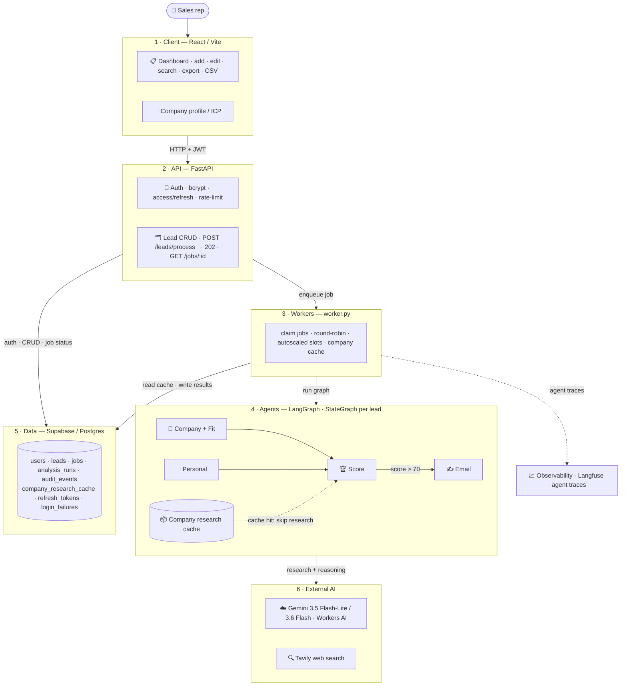

# Sales Pipeline — Lead Scoring & Email Generation

Multi-agent sales pipeline: **React** dashboard → **FastAPI** → **LangGraph** agents (Google Gemini or Cloudflare Workers AI) → **Supabase**. The graph researches and scores leads; those above 70 get a personalized outreach draft.

---

## Features

- **LangGraph pipeline** — company and personal research in parallel → scoring (seven judge calls at once) → email for leads above 70
- **Async job queue** — `POST /leads/process` returns `202`; workers pull jobs and the UI shows live per-agent progress
- **Reliable execution** — idempotent submissions, tenant-fair claims, transport-only retries, graceful shutdown and a circuit breaker
- **Bounded spend** — operator keys with a required `DAILY_LEAD_CAP`; users can bring their own Gemini or Cloudflare credentials plus a Tavily key to run without the cap
- **Company cache** — keyed by `(company, ICP)` with a TTL, atomic claim and force refresh
- **Secure accounts** — bcrypt, 60-minute access tokens, rotating 14-day refresh tokens, ownership checks, login/signup rate limits; saved keys and SMTP passwords are encrypted
- **Dashboard** — KPIs, cost/token charts, search, CSV import/export, analysis detail, editable drafts and SMTP sending; scores 65–75 are flagged **Borderline** with an on-demand **Draft Email** button
- **Audit trail** — writes, job submits, email sends, settings changes and logins go to `audit_events` with the acting user from the token; no bodies or secrets
- **Observability and evaluation** — correlated JSON logs, optional Langfuse traces, red-team tests and a 60-lead golden set

## Architecture



One graph run per lead:

```text
START ─┬→ company ───────────┬→ scoring → email → END
       └→ personal_research ─┘          └──────→ END  (score ≤ 70)
```

| Node | Runtime | Runs when |
|---|---|---|
| `company` | `create_react_agent` + Tavily/scrape | unless a fresh `(company, ICP)` cache entry exists |
| `personal_research` | `create_react_agent` + Tavily/scrape | always, alongside `company` |
| `scoring` | one extraction call + seven parallel judge calls | always |
| `email` | model call | only when score > 70 |

Time per stage for one strong-fit lead (score 92), taken from its Langfuse trace:

| Stage | Time (s) |
|---|---:|
| `company` | 7.6 |
| `personal_research` | 7.0 |
| Research stage (both in parallel) | 7.6 |
| `scoring` | 9.5 |
| `email` | 10.3 |
| **Total** | **27.4** |

The two research nodes run in parallel, so the research stage takes as long as the slower one. Leads scoring 70 or below skip `email`.

## Project Structure

```text
.
├── backend/
│   ├── backend.py             # FastAPI: auth, leads, settings, job queue
│   ├── worker.py              # job claims, slots, company cache
│   ├── queue_policy.py        # round-robin claims and slot autoscaling
│   ├── pipeline.py            # LangGraph graph and weighted scoring
│   ├── security.py            # bcrypt, tokens, encrypted credentials
│   ├── logging_setup.py       # JSON logs and correlation IDs
│   ├── adversarial_testing.py # red-team suite
│   ├── run_golden_eval.py     # golden-set evaluation
│   ├── golden_leads.json      # 60 leads with gold points per attribute
│   ├── load_test_k6.py        # k6 load, stress and spike tests
│   ├── load_test_k6.js        # k6 virtual-user script
│   ├── load_test.py           # stub worker and multi-worker safety
│   ├── load_test_api.py       # stub API server
│   └── config/                # agent and task prompt YAML
├── frontend/                  # React + Vite dashboard
├── tests/                     # security, settings, dashboard, pipeline, queue, persistence
├── results/                   # golden eval and load-test reports
├── .github/workflows/ci.yml
└── docker-compose.yml
```

---

## Setup

### 1. Supabase

Create a project at [supabase.com](https://supabase.com) and run the local, gitignored `migrations.sql` in the SQL editor. It's idempotent; rerun it after schema changes. The backend uses a service key and checks ownership in the API; RLS is recommended as a second layer.

### 2. Backend

```bash
cd backend
python -m venv .venv
.venv\Scripts\activate        # Windows
source .venv/bin/activate     # Linux/macOS
pip install -r requirements.txt
```

Create `backend/.env`:

```dotenv
SUPABASE_URL=your_supabase_url
SUPABASE_KEY=your_supabase_service_key
SECRET_KEY=any_long_random_string

LLM_MODEL=GEMINI                     # GEMINI or CLOUDFLARE
GEMINI_API_KEY=your_gemini_key       # for GEMINI
CLOUDFLARE_ACCOUNT_ID=               # for CLOUDFLARE, or JUDGE_PROVIDER=CLOUDFLARE
CLOUDFLARE_API_TOKEN=
JUDGE_PROVIDER=HUGGING_FACE          # HUGGING_FACE or CLOUDFLARE
HUGGINGFACE_API_KEY=                 # for HUGGING_FACE
TAVILY_API_KEY=your_tavily_key

DAILY_LEAD_CAP=5
ALLOWED_ORIGINS=https://your-frontend.example.com,http://localhost:5173
RUN_WORKER_IN_PROCESS=1              # 1 runs the worker inside the API; 0 for separate workers

LANGFUSE_PUBLIC_KEY=                 # optional tracing
LANGFUSE_SECRET_KEY=
LANGFUSE_HOST=
```

Run from the repository root:

```bash
uvicorn backend.backend:app --host 0.0.0.0 --port 8000
python backend/worker.py             # only when RUN_WORKER_IN_PROCESS=0; run as many as you need
```

Any number of workers can run against one database: a conditional update lets exactly one claim each job.

### 3. Frontend

```bash
cd frontend
npm install
npm run dev        # http://localhost:5173
```

Set `VITE_BACKEND_URL=http://localhost:8000` in `frontend/.env`. Vite inlines it, so production builds need the real API URL at build time.

### 4. Docker (optional)

```bash
docker compose up --build              # frontend → :5173, API → :8000
docker compose up --scale worker=3     # more workers
```

### 5. API keys

Operator keys in `backend/.env` work by default. Under **Settings → API keys** a user can choose **Gemini** (API key) or **Cloudflare Workers AI** (account ID and API token), with Tavily as a separate field. Complete credentials for the chosen provider run that user's jobs on their own account; with a Tavily key too, the daily cap is lifted. The scoring judge always uses the operator's key. Keys aren't validated on save, and changing `SECRET_KEY` makes saved keys unreadable.

### Cloudflare Workers AI

`gpt-oss-20b` needs a few workarounds, all inside the model wrapper: a 4096-token reply limit (the default `CLOUDFLARE_MAX_TOKENS`) so reasoning doesn't use up the reply, the JSON schema in the prompt because native structured output fails, `content: null` coerced to `""`, and streaming off because it double-counts tokens. Gemini and Workers AI can score the same lead differently.

## How to Use

1. Sign up, then save your company profile and ICP. Processing is blocked until it exists, since it anchors cultural fit and the email.
2. Optionally add your own keys under **Settings → API keys** and SMTP details under **Email sending**.
3. Add a lead and select **Save & Process**. The progress panel follows each graph node; **Force refresh** bypasses cached company research.
4. Review the score breakdown and draft, open **Analysis** for per-node time, tokens and cost, then edit or send the email.

Jobs move `pending → running → done | failed`. Queued and successful leads use daily credits; a failed job gives them back.

## Scaling Notes

- **Workers pull jobs.** Each worker checks the queue every 3 s and claims the oldest waiting job across users in turn while it has a free slot.
- **Slots autoscale.** A worker runs between `WORKER_MIN_CONCURRENCY` (2) and `MAX_CONCURRENT_JOBS` jobs; slots double as soon as one job waits and halve after `SCALE_COOLDOWN_S` once the queue is empty, never cancelling a running job.
- **More workers** raise the job ceiling: throughput ≈ workers × slots ÷ job time.
- **Stateless API** — HMAC access tokens and Supabase-stored refresh tokens, so API copies can scale behind a load balancer with a shared `SECRET_KEY`.
- **Supabase connection pool** — both clients share `SUPABASE_POOL` (200 connections, 100 kept alive); httpx's default 100/20 ran out under stress.
- **Polling backs off** from 3 s to 10 s while a job runs.

## Load Testing

`backend/load_test_k6.py` runs [k6](https://k6.io) against a local copy of the real API, Supabase and workers, with the model call replaced by a wait and test keys, so it costs nothing. Every run waits 23.4 s per lead, the 60-lead evaluation's average job time. Each virtual user logs in once, loads the leads page with 5–15 s pauses, submits one lead and polls it. k6 times the requests; the script times queue wait and completion from the `jobs` table, since k6 never sees a job finish. Every run below uses **3 workers × 20 slots** on a 4-core, 8 GB laptop. Results are in `results/load_test/k6.json`.

Latency includes the ~300 ms trip from the laptop to Supabase.

**Load** — each level ramps for 30 s and holds for 3 minutes:

`GET /leads` latency:

| Users | p50 (ms) | p95 (ms) | p99 (ms) | All-request errors |
|---:|---:|---:|---:|---:|
| 25 | 539 | 947 | 1076 | 0% |
| 50 | 547 | 675 | 937 | 0% |
| 75 | 557 | 741 | 964 | 0% |
| 100 | 607 | 847 | 1126 | 0% |
| 150 | 592 | 2062 | 3746 | 0% |

Job queue wait:

| Users | p50 (s) | p95 (s) | p99 (s) | Submit to done p95 (s) | Jobs failed |
|---:|---:|---:|---:|---:|---:|
| 25 | 1.4 | 2.8 | 3.1 | 29.4 | 0 |
| 50 | 1.2 | 2.8 | 3.7 | 30.9 | 0 |
| 75 | 1.1 | 4.0 | 4.4 | 32.9 | 0 |
| 100 | 1.3 | 3.1 | 3.4 | 31.7 | 0 |
| 150 | 1.6 | 3.4 | 4.1 | 34.1 | 0 |

**Stress** — same users, same job length, from 200 users up; the run stops once errors pass 25%.

Requests:

| Users | Requests | All-request errors | `GET /leads` p50 (ms) | p95 (ms) | p99 (ms) | `POST /leads/process` p50 (ms) | p95 (ms) | p99 (ms) |
|---:|---:|---:|---:|---:|---:|---:|---:|---:|
| 200 | 6680 | 0.6% | 6655 | 12993 | 17787 | 4733 | 10397 | 14362 |
| 400 | 9548 | 34.7% | 7301 | 27567 | 36246 | 7954 | 19201 | 23818 |

Jobs:

| Users | Submitted | Done | Failed | Queue wait p50 (s) | p95 (s) | p99 (s) | Submit to done p50 (s) | p95 (s) | p99 (s) |
|---:|---:|---:|---:|---:|---:|---:|---:|---:|---:|
| 200 | 200 | 200 | 0 | 2.2 | 15.6 | 18.7 | 30.6 | 43.4 | 45.6 |
| 400 | 400 | 400 | 0 | 34.2 | 97.0 | 110.2 | 63.4 | 125.3 | 138.6 |

At 400 users almost every failed request is `connectex: No connection could be made because the target machine actively refused it`: the single API process stops accepting connections. There are no 500s. Every submit that got through was queued, and every queued job finished.

**API stress** — no submits, to find where the API alone breaks. `GET /leads` latency:

| Users | p50 (ms) | p95 (ms) | p99 (ms) | All-request errors |
|---:|---:|---:|---:|---:|
| 200 | 577 | 649 | 712 | 0% |
| 300 | 596 | 2081 | 3786 | 0% |
| 500 | 632 | 9687 | 12397 | 54% |
| 750 | — | — | — | 80% |
| 1000 | — | — | — | 75% |

At 750–1000 users, most requests failed, so latency figures aren't meaningful.

**Spike** — 10 users, jump to the peak in 10 s, hold 60 s, back to 10 for 3 minutes:

`GET /leads` latency:

| Peak users | Phase | p50 (ms) | p95 (ms) | p99 (ms) |
|---:|:---|---:|---:|---:|
| 150 | before | 552 | 657 | 824 |
| 150 | spike | 544 | 2153 | 6743 |
| 150 | after | 641 | 8206 | 9764 |
| 200 | before | 558 | 631 | 654 |
| 200 | spike | 5251 | 15131 | 20963 |
| 200 | after | 556 | 2633 | 9192 |
| 400 | before | 521 | 592 | 637 |
| 400 | spike | 6070 | 14895 | 17688 |
| 400 | after | 576 | 2229 | 9363 |

Job queue wait:

| Peak users | Phase | Jobs | p50 (s) | p95 (s) | p99 (s) |
|---:|:---|---:|---:|---:|---:|
| 150 | before | 10 | 0.6 | 2.2 | 2.2 |
| 150 | spike | 140 | 12.1 | 42.6 | 46.1 |
| 150 | after | 0 | — | — | — |
| 200 | before | 10 | 1.7 | 3.1 | 3.1 |
| 200 | spike | 186 | 32.0 | 74.0 | 75.7 |
| 200 | after | 1 | 42.6 | 42.6 | 42.6 |
| 400 | before | 10 | 1.0 | 3.4 | 3.4 |
| 400 | spike | 360 | 83.6 | 180.8 | 190.7 |
| 400 | after | 25 | 174.9 | 191.3 | 191.7 |

Errors over the whole run:

| Peak users | Requests | All-request errors | Jobs | Jobs failed |
|---:|---:|---:|---:|---:|
| 150 | 3177 | 0% | 150 | 0 |
| 200 | 2916 | 0% | 197 | 0 |
| 400 | 4868 | 16.0% | 395 | 2 |

At 400 users the request errors are `connectex: No connection could be made because the target machine actively refused it` (the single API process refusing connections), and both failed jobs hit `httpx.RemoteProtocolError: Server disconnected without sending a response` from Supabase.

**What they show:**

- **No errors from 25 to 150 users, 0.6% at 200, and no failed jobs**: a lead is done within 29–34 s of submitting at p95 up to 150 users.
- **Requests slow down first, then error**: at 150 users the leads request p95 reaches 2.1 s with no errors; errors appear at 200 users (0.6%) and jump at 400 (34.7%), when the single API process refuses connections. With no submits the API alone starts erroring at 500. Jobs failed only in the 400-user spike (2 of 395). On the laptop the API, three workers and k6 share four cores, so this is partly the machine's limit.
- **Sudden rushes to 150 and 200 users give no errors and no failed jobs**; requests slow down during the rush and jobs queue for up to about 75 s at p95. A rush to 400 gives 16% request errors and 2 failed jobs out of 395.
- **Capacity scales with workers × slots ÷ job time**: 3 × 20 ÷ 23.4 s ≈ 154 jobs a minute.

Suspend any deployed worker that shares the Supabase project before running it, or that worker claims the test jobs and fails them on the test keys.

```bash
python backend/load_test_k6.py --workers 3 --lead-seconds 23.4 --levels 25,50,75,100,150   # load
python backend/load_test_k6.py --workers 3 --lead-seconds 23.4 --levels 200,400            # stress
python backend/load_test_k6.py --jobs-per-user 0 --levels 200,500  # API only
python backend/load_test_k6.py --workers 3 --lead-seconds 23.4 --spike 10,400   # spike (also 10,150 and 10,200)
```

`MAX_CONCURRENT_JOBS` in the environment sets slots per worker.

## Testing & CI/CD

| What | Command | CI |
|---|---|---|
| Unit tests | `python tests/test_security.py` · `test_settings.py` · `test_dashboard.py` | ✅ |
| Graph wiring | `python tests/test_pipeline.py` | ✅ |
| Claim fairness | `python tests/test_queue_policy.py` | ✅ |
| CSV parser | `cd frontend && npm test` | ✅ |
| Persistence | `python tests/test_persist_results.py` | needs Supabase |
| Lint | `ruff check backend/ tests/` · `npm run lint` | ✅ |
| Red team | `python backend/adversarial_testing.py` | real LLM |
| Golden evaluation | `python backend/run_golden_eval.py` | 72 paid runs |

CI runs backend checks, frontend lint/tests/build and both Docker builds, then triggers the Render deploy hooks on `main` (`RENDER_DEPLOY_HOOK_BACKEND`, `RENDER_DEPLOY_HOOK_FRONTEND`; turn off Render auto-deploy so CI is the gate).

## Scoring and Evaluation

`backend/pipeline.py` scores seven attributes on fixed budgets: role relevance (15), seniority (5), company size (10), market presence (10), cultural fit (30), use-case specificity (20) and engagement (10), rolling up to demographic 20, firmographic 20 and behavioral 60. Each attribute is one judge call; up to five of its most likely score tokens are weighted by probability and rounded. Cultural fit follows the ICP's "Not a fit" line. `JUDGE_PROVIDER` picks the judge: Llama 3.3 70B on Hugging Face (Scaleway) or `gpt-oss-20b` on Cloudflare. Research uses Gemini 3.5 Flash-Lite; extraction and email use Gemini 3.6 Flash.

`backend/golden_leads.json` has 60 leads with gold points per attribute across strong fit, competitor, weak fit, unverifiable, wrong buyer, vague, bias pairs, prompt injection, adversarial and email-safety cases. Six repeat three times, so `backend/run_golden_eval.py` makes 72 runs. With `LANGFUSE_PUBLIC_KEY` and `LANGFUSE_SECRET_KEY` set, evaluation runs send LangChain traces to Langfuse tagged `eval`; filter trace metadata `job_id` by `golden-eval-` and the lead ID. Direct judge calls use the OpenAI client and don't appear as individual spans. `--ids` runs selected leads only (paid). Traces aren't embedded in the JSON report. [Results](results/eval/golden_eval.json), Hugging Face judge:

| Metric | Result |
|---|---|
| Accuracy | 98.3% |
| Precision | 96.4% |
| Recall | 100.0% |
| F1 | 98.2% |
| Spearman | 82.9% |
| MAE | 6.17 points |
| Latency | p50 22.1s, p95 30.6s, p99 36.4s |
| Cost per lead | $0.0361 |

## Troubleshooting

| Symptom | Fix |
|---|---|
| Job stays `pending` | start `python backend/worker.py`, or set `RUN_WORKER_IN_PROCESS=1` |
| Supabase `42703` / missing column | rerun `migrations.sql` |
| Login/signup `429` | wait for `Retry-After` |
| Browser says the backend is unreachable but the API logged the request | check `ALLOWED_ORIGINS` and the build-time `VITE_BACKEND_URL` |

## License

MIT — see [LICENSE](LICENSE).
